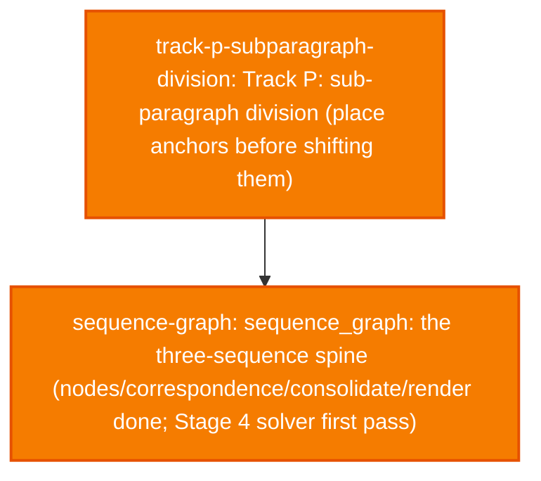

# Current Project State (SvZ)

Last updated: 2026-10-13 16:49

## Overall Progress

- [/] track-p-subparagraph-division: Track P: sub-paragraph division (place anchors before shifting them) — P0–P5: full write done. 376/590 days accepted; 661 cuts; axis 18946→19607; Δ sep +1355 on accepted days; gated fill 0.339.
- [/] sequence-graph: sequence_graph: the three-sequence spine (nodes/correspondence/consolidate/render done; Stage 4 solver first pass) — Stages 0-3b DONE. Stage 4: first pass, 4 move-set decisions, ALIGNED_TO write-back (gold+legacy+solver), Step 4.6 report, Step 4.7 cost fitting (15.1%->45.2% separated vs 73.9% uniform null), Step 4.7b exact_agreement fixed, Step 4.8 graph persisted + 2 scalability bugs fixed (legacy concordance missing, fit_cost/position_prior duplicate gold-parsing) -- all prior entries. NEW Step 4.9: two 'solve… (full text in docs/state.json)

_39 further task(s) archived — see docs/state_archive.json or `svz.py archived`._

## Active Focus

P5 successor written (376/590d, +1355 sep). Next: dual-ceiling Tier O on paragraph_axis_p5_predicted_v1.

## Key Intermediate Results & Metrics

- **sequence-graph — Stage 4 first pass, 1629-03-02 gold exact agreement (unfitted cost, standalone, not gated):** 0.6
- **sequence-graph — Stage 4 first pass, 1629-03-02 separated/k_e (1/5, unfitted cost, standalone):** 0.2
- **sequence-graph — Stage 4, 50 alignable gold days (456 k_e): separated unfitted/fitted/uniform-null -- fitted beats unfitted ~3x but loses to uniform null:** 69/206/337
- **sequence-graph — Positional prior (local uniform expectation): share within 1 paragraph of gold true position, excluding 2 known severe-mismatch days (320/344 resolutions):** 0.609
- **track-p-subparagraph-division — P0 signed off 2026-10-13: Phase-2 ceiling may rise under re-paragraph (1=yes):** 1
- **track-p-subparagraph-division — P3 offset-carry exact start agreement on synthetic_boundary_folds (2040 ex):** 1.0
- **track-p-subparagraph-division — P3 separated after offset-carry (k_e=4886; plain=0 uniform=0):** 4886
- **track-p-subparagraph-division — Main-series session-resolved ceiling (replaces same-day 11644 as live denominator):** 12048
- **track-p-subparagraph-division — Main-series theoretical max separated (k_e 14240 minus 127 nihil):** 14113
- **track-p-subparagraph-division — Hard structural floor: nihil_actum k_e only (retired 5590 no-HTR):** 127
- **track-p-subparagraph-division — P4 predicted-offset separated delta vs plain on 590 colliding days:** 1732
- **track-p-subparagraph-division — P4 typed Group-C cut fill rate (893/2053 needed):** 0.435
- **track-p-subparagraph-division — P5 gated days accepted (of 590 colliding):** 376
- **track-p-subparagraph-division — P5 separated delta vs plain on accepted days:** 1355
- **track-p-subparagraph-division — P5 cuts applied to paragraph_axis_p5_predicted_v1:** 661
- **track-p-subparagraph-division — P5 successor paragraph count (main series, in scope):** 19607

## Blockers / Open Questions

No blockers recorded.

## Next Actions

- Run `uv run python scripts/svz.py review` before picking work; see docs/ITERATION_POLICY.md.
- Dual-ceiling Tier O on paragraph_axis_p5_predicted_v1; residual typology under 12048/14113.
- Optional Phase-1 mop-up: early-1626 / 1626-11-04 — not Phase-2 steering.

<!-- Manual notes below this line are preserved by scripts/svz.py render. -->
## Notes

## MCP

- mcp_enabled: true
- mcp_server_path: /Users/rikhoekstra/develop/dighum_template/packages/workflow_mcp
- last_mcp_check: 2026-09-01T00:00:00Z
- current_step: 4a

## Dashboard
- docs/dashboard.md
