# Current Project State (SvZ)

Last updated: 2026-10-09 15:36

```mermaid
flowchart TD
    classDef done fill:#2e7d32,stroke:#1b5e20,color:#fff,stroke-width:2px;
    classDef inprogress fill:#f57c00,stroke:#e65100,color:#fff,stroke-width:2px;
    classDef todo fill:#424242,stroke:#212121,color:#ddd,stroke-width:1px,stroke-dasharray: 5 5;
    classDef blocked fill:#c62828,stroke:#b71c1c,color:#fff,stroke-width:2px;

    S0["S0: Boundary evaluation harness"]:::done
    S1["S1: Zero-annotation diagnostics"]:::done
    S2["S2: Anchor phrase inventory"]:::done
    S3_tooling["S3-tooling: Boundary gold tooling"]:::done
    S3_annotation["S3-annotation: Manual boundary annotation"]:::done
    S4["S4: Segmentation assembly (paragraph-axis baseline)"]:::done
    S4a["S4a: Session-date inputs"]:::done
    S4b["S4b: Session-date ledger"]:::done
    S4c["S4c: Nearby session candidates"]:::done
    S4d["S4d: Session status heatmap"]:::done
    S4e["S4e: Session-key consumers"]:::done
    S5["S5: Evaluation and review routing"]:::done
    line_level_segmentation["line-level-segmentation: Line-level cut points for the 12 structurally-abstaining gold days"]:::blocked
    track_b_name_matching["track-b-name-matching: Track B -- soundex/Levenshtein reranker for person-name matching"]:::done
    track_c_fuzzy_search_context["track-c-fuzzy-search-context: Track C -- FuzzyTokenSearcher context/role matching"]:::done
    entity_resolution_fix["entity-resolution-fix: Entity resolution fix (persons/orgs/places id->name bugs, build_alignment_new.py)"]:::done
    excel_overlap_builder_audit["excel-overlap-builder-audit: Audit place/org/per_overlap_1626_1630.xlsx builders for the same literal-substring bug"]:::done
    resolution_concordance_completeness["resolution-concordance-completeness: Resolution concordance completeness (N-status gaps, candidate scoring, window-widen)"]:::done
    ner_finetuning_original_goal["ner-finetuning-original-goal: GysBERT multi-class NER fine-tuning (original project goal, Phase 2+)"]:::done
    short_resolution_alignment["short-resolution-alignment: Short-resolution alignment (align_short_resolutions.py) -- decide: wire into concordance or retire"]:::done
    fuzzy_surface_form_scan["fuzzy-surface-form-scan: Corpus-wide fuzzy surface-form scan (s4_fuzzy_surface_form_scan.py) -- recover entities the tagger missed"]:::done
    interior_cut_evaluation_harness["interior-cut-evaluation-harness: Extend the boundary evaluation harness to credit sub-paragraph (interior) cuts"]:::done
    adopt_windowed_overlap_rebuild["adopt-windowed-overlap-rebuild: Adopt build_windowed_overlap.py's variant-aware rebuild as canonical place/org overlap; build the equivalent fuzzy pass for PER"]:::done
    s6_anchor_chain_alignment["s6-anchor-chain-alignment: S6 -- multi-channel anchor chaining at character coordinates"]:::done
    metrics_nihil_actum_invariant["metrics-nihil-actum-invariant: Tier V: nihil-actum invariant check"]:::done
    metrics_separation_span_table["metrics-separation-span-table: Tier O: consecutive-day separation span table"]:::done
    metrics_ke_drift_diagnostic["metrics-ke-drift-diagnostic: Tier D: per-day K_e drift-comparison diagnostic"]:::done
    metrics_bottleneck_diagnostic["metrics-bottleneck-diagnostic: Tier P: bottleneck diagnostic (evidence vs. algorithm)"]:::done
    metrics_consolidation_overhaul["metrics-consolidation-overhaul: Register the metrics-tier overhaul itself in state.json"]:::done
    metrics_local_inventory_ceiling["metrics-local-inventory-ceiling: metrics-local-inventory-ceiling"]:::done
    inventory_stream_collision_avoidance["inventory-stream-collision-avoidance: Inventory-stream reframing and collision avoidance (plans/COLLISION_AVOIDANCE_TRACK.md)"]:::done
    tfidf_embeddings_wiring["tfidf-embeddings-wiring: Wire TF-IDF semantic similarity into placement alignment"]:::inprogress
    resolution_loss_census["resolution-loss-census: Resolution loss census: where do the 5,746 unpaired resolutions go?"]:::done
    staged_anchor_consolidation["staged-anchor-consolidation: Staged anchor consolidation (plans/STAGED_ANCHOR_CONSOLIDATION.md)"]:::inprogress
    sequence_alignment["sequence-alignment: Sequence alignment: align the XML sitting-day calendar against the HTR session sequence"]:::done
    scan_sequence["scan-sequence: Scan sequence: a physically grounded coordinate (scan_id) instead of inferred session attribution"]:::done
    track_p_subparagraph_division["track-p-subparagraph-division: Track P: sub-paragraph division (place anchors before shifting them)"]:::inprogress
    track_s_anchor_shifting["track-s-anchor-shifting: Track S: anchor shifting (session reassignment)"]:::done
    archival_provenance["archival-provenance: Archival provenance: per-resolution secret flags and page/scan provenance"]:::inprogress
    sequence_graph["sequence-graph: sequence_graph: the three-sequence spine (nodes/correspondence/consolidate/render done; Stage 4 solver first pass)"]:::inprogress
    S0 --> S5
    S1 --> S4
    S2 --> S4
    S4a --> S4b
    S4b --> S4c
    S4c --> S4d
    S4c --> S4e
    S3_tooling --> S3_annotation
    S3_annotation --> S5
    S4 --> S5
    S4 --> line_level_segmentation
    entity_resolution_fix --> excel_overlap_builder_audit
```

## Overall Progress

- [x] S0: Boundary evaluation harness — Implemented boundary P/R/F1 at tolerance t, WindowDiff/P_k, and exact-count satisfaction; gold-data adapter remains part of S4 evaluation.
- [x] S1: Zero-annotation diagnostics — D1, D1c, D2, and D2b completed; findings support segmentation-transfer framing.
- [x] S2: Anchor phrase inventory — Harvested 1626-1630 opening/closing phrases to output/s2_anchor_phrase_inventory.json.
- [x] S3-tooling: Boundary gold tooling — Built sample generator, annotation UI, and merge script. Upstream res_start has zero target-inventory overlap.
- [x] S3-annotation: Manual boundary annotation — All 50 days annotated and merged. Exception review distinguishes segmentable, cross-day-shift, and missing-HTR cases.
- [x] S4: Segmentation assembly (paragraph-axis baseline) — CLOSED 2026-09-23. Both 2026-09-18 open items resolved same day (docs/DECISIONS.md): boundary F1 stagnation is a structural ceiling from gold's own duplicate paragraph_stream_index slots, and the 2 missing-record gold dates are trivial k_e=1/missing_htr days, not bugs. All live segmentation development since (predict_day/predict, S6a char axis, S6b anchor harvest, S6c segmentation DP) was carried… (full text in docs/state.json)
- [x] S4a: Session-date inputs — Composite inventory-date key defined and registered; data_io.check passes for all S4 inputs.
- [x] S4b: Session-date ledger — 4,916 inventory-date rows: T=1,012, A=4, E=97, X=3, N=3,800.
- [x] S4c: Nearby session candidates — +/-1-day candidates recorded without auto-assignment.
- [x] S4d: Session status heatmap — Per-inventory-year calendar heatmap rendered.
- [x] S4e: Session-key consumers — Review export and mapping-aware corpus segmentation consumer both produced.
- [x] S5: Evaluation and review routing — scripts/evaluate_s4_paragraph_axis.py excludes C/M days, reports coverage separately. Routing abstentions to sequence_review_ui.py still deferred pending the next real S4 iteration.
- [!] line-level-segmentation: Line-level cut points for the 12 structurally-abstaining gold days — Per SEGMENTATION_TRANSFER.md section 9's fallback trigger. BLOCKED 2026-09-18, corrected 2026-09-18: canonical htr_classified_lines.csv has zero rows in inventories 3185-3189; the marijn-variant file has 1,294 checked rows in the right inventories but at spot-check density (2-9 pages/inventory), unmapped to dates. The page-to-date join is NOT a cheap check (see docs/DECISIONS.md 2026-09-18 'Correc… (full text in docs/state.json)
- [x] track-b-name-matching: Track B -- soundex/Levenshtein reranker for person-name matching — CLOSED 2026-09-23 by user judgment call (not expected to pay off), before any design or implementation work started. See docs/DECISIONS.md 2026-09-23.
- [x] track-c-fuzzy-search-context: Track C -- FuzzyTokenSearcher context/role matching — CLOSED 2026-09-24 without starting. Design-only Track C (FuzzyTokenSearcher context/role matching), doc-status:future in PLAN.md, never part of the active segmentation-transfer goal. S6b/S6c already tested the same class of fuzzy/phrase evidence against the actual canonical goal (position_scores, 5 variants) and found it net negative. See docs/DECISIONS.md 2026-09-24.
- [x] entity-resolution-fix: Entity resolution fix (persons/orgs/places id->name bugs, build_alignment_new.py) — Fixed silent id-as-name bugs for persons and institutions; built entity_surface_matches_1626_1630 cache (18,698 rows) for orthography fallback. Known limitation not fixed here -> excel-overlap-builder-audit.
- [x] excel-overlap-builder-audit: Audit place/org/per_overlap_1626_1630.xlsx builders for the same literal-substring bug — Confirmed the literal-substring bug for all three builders (see docs/DECISIONS.md 2026-09-19). Place +13.4% (1265/9428), org +4.0% (55/1363) rows recoverable via build_windowed_overlap.py's existing --compare-legacy rebuild, both zero-regression (legacy_only=0). Per confirmed by code inspection (no fuzzy pass in build_per_overlap.py); no rebuild script exists yet for it.
- [x] resolution-concordance-completeness: Resolution concordance completeness (N-status gaps, candidate scoring, window-widen) — Accepted as final 2026-09-18 (docs/DECISIONS.md): 70.7% resolved_auto, 28.6% missing_htr (structural ceiling, 49.7% of ledger has no HTR within +/-14d), 0.6% nihil_actum. Window-widen to +/-7d unlocked zero new confident matches. Closed track, not open for further work.
- [x] ner-finetuning-original-goal: GysBERT multi-class NER fine-tuning (original project goal, Phase 2+) — RETIRED 2026-09-24 (state.json synced to match PLAN.md's own canonical-goal text, which already called this retired). GysBERT multi-class NER fine-tuning would train on spans from the same ~50-55%-recall upstream tagger its own training data comes from, so it cannot close its own recall gap; output is unrelated to the current segmentation-transfer goal. Phase 1 data prep (21K LOC + 13K PER trainin… (full text in docs/state.json)
- [x] short-resolution-alignment: Short-resolution alignment (align_short_resolutions.py) -- decide: wire into concordance or retire — RETIRED 2026-09-22 with the LLM side-plan close (plans/SHORT_RESOLUTION_SIDE_PLAN.md Step 7). Formulaic align_short_resolutions.py stays an orphan: never measured, never wired into s6b_anchor_harvest A-D, never consumed by concordance. Closing the LLM ranking track removes the only active reason to keep Tier E on the board; do not wire-in without a new measured case. Script may remain in-repo as h… (full text in docs/state.json)
- [x] fuzzy-surface-form-scan: Corpus-wide fuzzy surface-form scan (s4_fuzzy_surface_form_scan.py) -- recover entities the tagger missed — CLOSED 2026-09-23. Full-dictionary FuzzyTokenSearcher scan (LOC/PER/ORG) over all 21,519 paragraph_axis_1626_1630 paragraphs completed 2026-09-21: 189,764 rows, 167,599 (88.3%) newly_recovered vs entity_surface_matches_1626_1630. Leverage was tested under s6-anchor-chain-alignment (this scan feeds s6b_anchor_harvest.py Group B): every position_scores variant using it regressed below the 0.644 no-e… (full text in docs/state.json)
- [x] interior-cut-evaluation-harness: Extend the boundary evaluation harness to credit sub-paragraph (interior) cuts — DONE 2026-09-20 via S6a (scripts/s6a_char_axis_evaluation.py, 14/14 tests). The harness now scores at character coordinates: gold (paragraph_stream_index, char_offset) composes to one integer axis per day by pure concatenation (no separator -- gold paragraph_boundary cuts carry char_offset == len(paragraph), so a paragraph-final cut composes to exactly the next paragraph's start). compute_boundary… (full text in docs/state.json)
- [x] adopt-windowed-overlap-rebuild: Adopt build_windowed_overlap.py's variant-aware rebuild as canonical place/org overlap; build the equivalent fuzzy pass for PER — 2026-09-19: place/org canonical overlap swapped to variant-aware rebuild. 2026-09-21: PER canonical overlap swapped (build_per_overlap.py extended, +415 rows). 2026-09-21: downstream re-run done (build_alignment_new.py 11:43, s4_corpus_paragraph_predictions.py 11:44) against all three swapped tables. 2026-09-21: checked build_alignment_new.py's own headline confidence_tier distribution pre- vs pos… (full text in docs/state.json)
- [x] s6-anchor-chain-alignment: S6 -- multi-channel anchor chaining at character coordinates — 2026-09-23: position_scores tuning closed. Five variants of Group-B evidence (blanket/day-grounded/relocated/exact-relocated/gap-candidate-grounded) and Group-C phrase-hit evidence all tested below the 0.644 no-evidence paragraph-tol0 baseline -- the bonus-vs-even-split mechanism in segment_gap, not the evidence source, is the limiting factor. Lever (b) (per-entity role/type weighting) was the las… (full text in docs/state.json)
- [x] metrics-nihil-actum-invariant: Tier V: nihil-actum invariant check — Built scripts/metrics_nihil_actum_invariant.py. Concordance+ledger check: invariant_passed=True, 127 nihil days, 0 violations. Emits shared per-day K_e series (k_e_signal=0 on nihil) for Tier D/O.
- [x] metrics-separation-span-table: Tier O: consecutive-day separation span table — Built scripts/metrics_separation_span_table.py. Separated=1961 (16.8% of ceiling); solid_days=221/1594; Global spans@30 unmet at gap 0/1/2 (longest 6/9/9 calendar days).
- [x] metrics-ke-drift-diagnostic: Tier D: per-day K_e drift-comparison diagnostic — Built scripts/metrics_ke_drift_diagnostic.py on Tier V day series. 203 drift candidates at |dev|>=10 vs ±3d neighbor median; 0 blocked by V. Candidates are suspects, not proven errors.
- [x] metrics-bottleneck-diagnostic: Tier P: bottleneck diagnostic (evidence vs. algorithm) — Built scripts/metrics_bottleneck_diagnostic.py. oracle_coverage=0.263 (5/19), real_coverage=0.368 (7/19), recommended_focus=algorithm_redesign. Real>oracle is thin-anchor monotone dodge (same as endpoints density), not evidence that NW anchors beat perfect gold.
- [x] metrics-consolidation-overhaul: Register the metrics-tier overhaul itself in state.json — Closed 2026-09-22: docs/METRICS.md channel tiers O/P/A-E/V/X in place; V/D/O/P implemented (E retired). Overhaul complete.
- [x] metrics-local-inventory-ceiling: metrics-local-inventory-ceiling — DONE 2026-09-24. Built scripts/metrics_local_inventory_ceiling.py: per-date pigeonhole ceiling = min(k_e, same-calendar-day raw paragraph_count), summed per inventory_id. Reproduces the cited corpus-wide 11,644 ceiling exactly (and 535 no-HTR dates), closing docs/METRICS.md's 'Known gaps' item. PLAN.md's Local criterion is MET: all 5 main annual inventories (3185-3189) clear >=50% of their own cei… (full text in docs/state.json)
- [x] inventory-stream-collision-avoidance: Inventory-stream reframing and collision avoidance (plans/COLLISION_AVOIDANCE_TRACK.md) — SUPERSEDED 2026-10-09: all gates were already PASS/NEGATIVE/closed. Its one open coupling (PINNED_TO monotonicity) is replaced by sequence_graph's monotone_map. See docs/SEQUENCE_MODEL.md, plans/SEQUENCE_GRAPH_SPINE.md.
- [/] tfidf-embeddings-wiring: Wire TF-IDF semantic similarity into placement alignment — Step 0 complete: paragraph-granularity AUC = 0.893 (target 0.70), clears gate to wiring. Threshold 0.35 admits ~75% of positives (20 percentile), semantic_weight calibration pending Step 1.
- [x] resolution-loss-census: Resolution loss census: where do the 5,746 unpaired resolutions go? — Completed 2026-09-29, extended 2026-10-05. Duplicate session-claim disambiguation: 25/67 decided via date headings, zero spurious, all shared; gate costs 428/8,084 separated (5.3%) where undecided. Follow-on explanatory-coverage ledger (v1a/v1b/v1c) agreed with user but not started.
- [/] staged-anchor-consolidation: Staged anchor consolidation (plans/STAGED_ANCHOR_CONSOLIDATION.md) — Steps 1-3 done, Step 4 pre-check done 2026-10-02 (Group B deferred, see docs/DECISIONS.md). Steps 4a/4b (staged vs combined channel wiring) not yet run.
- [x] sequence-alignment: Sequence alignment: align the XML sitting-day calendar against the HTR session sequence — SUPERSEDED 2026-10-09: this track's question (DATED_AS vs PINNED_TO disagreement) is Stage 2 of sequence_graph. The NEXT item (heading dates into the weekly-walk aligner) is withdrawn -- monotone_map is the one primitive, not a bespoke feed. Measured history (misattribution finding, drift retraction) stands and seeded the spine.
- [x] scan-sequence: Scan sequence: a physically grounded coordinate (scan_id) instead of inferred session attribution — SUPERSEDED 2026-10-09: OBSERVED_ON + DATED_AS are now sequence_graph edges. reconcile_sequences.py / bracket_gap_census.py / bracket_business_ledger.py / type_scan_gap_findings.py are the duplicated logic Stage 5 retires. Every measured number (610/1,054 anchors, 155/593 room<charge, 323/406/261 reconciliation) is now a regression target for Stage 2's gate, not a line to extend.
- [/] track-p-subparagraph-division: Track P: sub-paragraph division (place anchors before shifting them) — P1 PASS: typed formula channel beats the null, ranked 0.62, day-clustered p=0.0003. P2 closed at 12 gold/80 (thin yield), redirected to synthetic_boundary_* 2,041 proven-pair rows. P3 NOT YET IMPLEMENTED and is the only open item in the project with a direct line to the separated metric.
- [x] track-s-anchor-shifting: Track S: anchor shifting (session reassignment) — SUPERSEDED 2026-10-09: S2's many-to-many date<->session schema IS PINNED_TO as an unconstrained edge set in sequence_graph -- building it separately would duplicate the spine. S1's +186/-186 sizing stands as a Stage-2 regression check. The calibrated-anchor-scoring question migrates to Stage 4 (the solver).
- [/] archival-provenance: Archival provenance: per-resolution secret flags and page/scan provenance — Per-resolution secret flags recovered from source XML; resolution_archival_provenance built (71.7% resolved, 100% of those carry pages) and it is the join that made bracket_business_ledger possible. Secret-session hijack mechanism (34 days / 398 resolutions) measured and UNBLOCKED at <=0.07% of separated cost, not yet built.
- [/] sequence-graph: sequence_graph: the three-sequence spine (nodes/correspondence/consolidate/render done; Stage 4 solver first pass) — Stages 0-3b DONE. Stage 4: first pass, 4 move-set decisions, ALIGNED_TO write-back (gold+legacy+solver), Step 4.6 report, Step 4.7 cost fitting (15.1%->45.2% separated vs 73.9% uniform null), Step 4.7b exact_agreement fixed, Step 4.8 graph persisted + 2 scalability bugs fixed (legacy concordance missing, fit_cost/position_prior duplicate gold-parsing) -- all prior entries. NEW Step 4.9: two 'solve… (full text in docs/state.json)

_1 further task(s) archived — see docs/state_archive.json or `svz.py archived`._

## Active Focus

sequence_graph is the spine (docs/SEQUENCE_MODEL.md; plan: plans/SEQUENCE_GRAPH_SPINE.md). Stages 0-3b DONE 2026-10-09, all gates PASS (872 tests, 84 new). Stage 4 (the solver, align.py) first pass DONE 2026-10-09, later the same day: four decisions answered by the user, align_bracket built and tested (11 tests), run once on the scoped clean bracket (1629-03-02): 3/5 gold exact agreement, 1/5 separated. Not gated, not fitted, not benchmarked against the three existing DP mechanisms -- cost fitting and the mechanism comparison are next session's short list. A separate gap raised 2026-10-09 is also still open and NOT locked into the Stage 4 design: nihil-as-SKIP, DATED_AS strict/bootstrap as solver-visible subtypes, Track P's CONTAINS refinement vs ALIGNED_TO identity, and whether to forbid HTR-side insertion in the move set. Stage 5 (retiring legacy scripts) not started. The separated metric itself has not moved -- nothing built so far changes a production placement.

## Key Intermediate Results & Metrics

- **S1-D1 — HTR under-segmented session-days:** 81.1%
- **S1-D1 — Exact K_f == K_e session-days:** 3.8%
- **S1-D1 — Mean entity containment:** 0.295
- **S1-D1c — Tier-1 Kendall tau:** 0.638; 64.3% of pairs at tau >= 0.8
- **S1-D2 — LLM judge precision:** 60.0% against 53.7% baseline
- **S1-D2b — Opening formula hit rate:** 80.1%
- **S4 — Flat-resolution entity-NW baseline coverage:** 0 / 50 predicted
- **S4 — Paragraph-axis resolved entity coverage:** 480 / 611 paragraphs; 87 unresolved annotation references
- **S4 — Boundary micro F1 (tolerance 0):** 0.576 (stagnant, Δ+0.000)
- **S4 — Boundary micro F1 (within 2 paragraphs):** 0.727 (stagnant, Δ+0.000)
- **S4 — Predicted-day coverage (of 21 eligible gold days):** 0.429 (improving, Δ+0.191)
- **S4 — Opening signal at manual cuts:** 227/360 regex (63.1%); 225/360 S2 top-20 phrases (62.5%)
- **S4 — fuzzy_search opening coverage:** 225/360 (62.5%), unchanged from exact top-20 phrase matching
- **S4 — Held-out opening phrase inventory:** 271 candidates from 3,817 tier-1 flat records; excludes 50 gold dates
- **S4 — Corpus paragraph axis:** 21,519 paragraphs; 16,104 entity-bearing; 41,156 resolved attachments
- **S4 — Corpus entity-NW baseline:** 244/1,594 predicted; 815 insufficient anchors; 535 no same-day HTR assignment
- **resolution-concordance-completeness — Resolved-auto share of resolution-level concordance:** 70.7%
- **resolution-concordance-completeness — Missing-HTR share (accepted structural ceiling):** 28.6%
- **S4 — Common-language effect size, bundled vs clean-boundary paragraph entity_annotation_count (gold, n=22/112):** 0.770
- **S4 — NER-only entity spans, even-split heuristic, tol=150 chars:** 0.333
- **S4 — NER + entity_surface_matches dictionary lookup, tol=150 chars:** 0.407
- **S4 — NER-only entity spans, even-split heuristic, tol=50 chars:** 0.0
- **S4 — NER + dictionary lookup, tol=50 chars:** 0.111
- **S4 — NER-only spans + phrase-boundary snap, tol=50 chars:** 0.074
- **S4 — NER-only spans + phrase-boundary snap, tol=150 chars:** 0.333
- **S4 — NER + dictionary + phrase-boundary snap, tol=50 chars:** 0.148
- **S4 — NER + dictionary + phrase-boundary snap, tol=150 chars:** 0.407
- **excel-overlap-builder-audit — 1265/9428 additional rows found by build_windowed_overlap.py's variant+tag_text passes vs legacy canonical-only place_overlap_1626_1630.xlsx (window_days=0, --c… (full text in docs/state.json):** 0.1342
- **excel-overlap-builder-audit — 55/1363 additional rows found by build_windowed_overlap.py's variant pass vs legacy canonical-only org_overlap_1626_1630.xlsx (window_days=0, --compare-legacy:… (full text in docs/state.json):** 0.0404
- **excel-overlap-builder-audit — Confirmed by code inspection: build_per_overlap.py has no fuzzy/variant pass at all (exact tag_text substring, then exact-word surname_token fallback only). Dir… (full text in docs/state.json):** 1.0
- **s6-anchor-chain-alignment — Hard recall bound AT TOLERANCE 0 on the 50-day gold set under (paragraph_stream_index, char_offset): 320/352 distinct cut positions, vs 280/352 (0.795) under pa… (full text in docs/state.json):** 0.909
- **s6-anchor-chain-alignment — S6a STRICT ceiling: 313/352 distinct character positions reachable at tolerance 0 on the 50-day gold set, vs 280/352 (0.795) under paragraph indices. Higher is… (full text in docs/state.json):** 0.889
- **s6-anchor-chain-alignment — S6a re-scored baseline: micro F1 at tolerance 0 CHARACTERS for the unchanged 2026-09-18 s4_paragraph_axis_predictions, composed onto the character axis. Higher… (full text in docs/state.json):** 0.467
- **s6-anchor-chain-alignment — S6a re-scored baseline: micro F1 at tolerance 150 characters (matching the split-POC harness scale). Higher is better.:** 0.567
- **interior-cut-evaluation-harness — 22 of 24 folded gold groups (16 days) gain distinct character coordinates under (paragraph_stream_index, char_offset) composition. Higher is better. The 2 that… (full text in docs/state.json):** 0.917
- **s6-anchor-chain-alignment — S6 Step 1 oracle diagnostic: with a PERFECT gold-derived anchor set, the current placement model (interpolate_positions + snap_boundaries, unmodified) can predi… (full text in docs/state.json):** 0.263
- **s6-anchor-chain-alignment — S6 Step 1 oracle diagnostic: micro F1 at tol 50 chars on the 5 days perfect anchors can predict (tol0 0.727, tol150 0.788). Higher is better. Caps below 1.0 bec… (full text in docs/state.json):** 0.788
- **s6-anchor-chain-alignment — S6a LUMPED baseline: gold cuts collapsed onto the paragraph they open (interior cuts credited at their paragraph start, de-duplicated) and model output collapse… (full text in docs/state.json):** 0.828
- **s6-anchor-chain-alignment — S6b constraint baseline, contiguous 1626-01-01..06-30: 389 of 1218 enriched resolutions are pinned by a typed known point (366 tier-1 anchors, 41 gold boundarie… (full text in docs/state.json):** 0.319
- **s6-anchor-chain-alignment — S6b constraint baseline: 544 of 723 unplaced resolutions sit in the 93 gaps holding more than 2 resolutions. LOWER is better. Counting GAPS flatters this badly… (full text in docs/state.json):** 0.752
- **s6-anchor-chain-alignment — S6b constraint baseline, FULL period 1626-1630: 5111 of 13530 enriched resolutions pinned by a typed known point (4761 tier-1 anchors, 350 gold boundaries). Hig… (full text in docs/state.json):** 0.378
- **s6-anchor-chain-alignment — S6b constraint baseline, FULL period: 5302 of 7504 unplaced resolutions sit in the 947 gaps holding more than 2 resolutions, spanning 3.13M characters. LOWER is… (full text in docs/state.json):** 0.707
- **adopt-windowed-overlap-rebuild — PER variant-aware rebuild vs legacy literal-substring build: legacy_only=0 (strict superset), shared=7544, rebuilt_only=415. Higher is better.:** 415
- **s6-anchor-chain-alignment — S6b anchor harvest, 36-day smoke window (1626-01-01..03-01, preliminary, not corpus-wide): group A (tier1_entity_nw) 149 anchors/32 days; group B (entity_surfac… (full text in docs/state.json):** 0.0
- **s6-anchor-chain-alignment — S6b anchor harvest, FULL CORPUS 1626-1630: 247,871 anchor rows over 1,240 days-with-axis. Of the 815 corpus-wide insufficient_entity_anchors abstentions, only 5… (full text in docs/state.json):** 0.072
- **s6-anchor-chain-alignment — S6b anchor harvest, FULL CORPUS: per-channel density (anchors / distinct positions / days-touched of 1,240 days-with-axis). A tier1_entity_nw: 5,332/3,718/993.… (full text in docs/state.json):** 6.99
- **adopt-windowed-overlap-rebuild — Post-rebuild build_alignment_new.py re-run (2026-09-21, refreshed place/org/per overlap tables), alignment_1626_1630.parquet, n=13342 (unchanged): tier1_anchor… (full text in docs/state.json):** 0.0195
- **s6-anchor-chain-alignment — 19/21 eligible gold days predicted (was 9/21 pre-S6c):** 0.905
- **s6-anchor-chain-alignment — S6c segmentation DP, was 0.828 pre-S6c (baseline unchanged within noise):** 0.826
- **s6-anchor-chain-alignment — S6c segmentation DP on nearly 3x the predicted days (19 vs 7), was 0.500 pre-S6c:** 0.503
- **s6-anchor-chain-alignment — was 777 pre-S6c; eliminated entirely (1059 = 282 pre-existing + all 777 recovered):** 0
- **s6-anchor-chain-alignment — 1059/1059 days with an axis now predict (535 missing_htr, structural, untouched):** 1.0
- **s6-anchor-chain-alignment — Predicted days with 7+ resolutions collapsed onto one paragraph (83/1140) after the axis_for_date fix; was 92/1140=0.0807 pre-fix, 79/1059=0.075 before the conc… (full text in docs/state.json):** 0.0728 (stagnant, Δ-0.002)
- **s6-anchor-chain-alignment — was 535 pre-wiring; 81 days recovered via resolution_concordance_1626_1630's resolved_session_id:** 454
- **s6-anchor-chain-alignment — S6b prerequisite: resolutions_flat session -> raw session content-fingerprint match rate (substring containment on 'para'-class text), registered as s6b_session… (full text in docs/state.json):** 0.701
- **s6-anchor-chain-alignment — session_day_find (S6b Group-D channel): 25/25 sampled hits genuine at FuzzyPhraseSearcher threshold 0.95+ignorecase, 154 hits/130 sessions vs regex baseline's u… (full text in docs/state.json):** 1.0
- **s6-anchor-chain-alignment — session_day_find corpus-wide: 203 anchors / 162 of 1240 days-with-axis (13.1%), 203 distinct positions -- smallest of all six non-sentinel channels (vs group A… (full text in docs/state.json):** 0.131
- **s6-anchor-chain-alignment — s4_corpus_paragraph_predictions.py's predict(), with s4_opening_phrase_candidates fed into segment_day's position_scores, scored on the 19/21 scoreable gold day… (full text in docs/state.json):** 0.622
- **metrics-nihil-actum-invariant — Tier V nihil-actum invariant_passed (1=pass, 0=fail):** 1
- **metrics-nihil-actum-invariant — Tier V nihil_share_of_days (127/1594):** 0.0797
- **metrics-ke-drift-diagnostic — Tier D K_e drift candidates (|dev|>=10 vs ±3d neighbor median); lower after genuine fixes is better:** 203
- **metrics-separation-span-table — separated resolutions (unique start + extent<=3):** 1961
- **metrics-separation-span-table — solid days (separated_share>=0.5 on k_e_signal):** 221
- **metrics-separation-span-table — Global spans @30d gap=1 (n_spans; criterion >=6):** 0
- **metrics-separation-span-table — Global spans @30d gap=1 (days covered; criterion >=180):** 0
- **metrics-bottleneck-diagnostic — oracle_ceiling coverage (perfect anchors + interpolate_positions):** 0.263
- **metrics-bottleneck-diagnostic — real_performance coverage (NW anchors + interpolate_positions):** 0.368
- **metrics-bottleneck-diagnostic — bottleneck recommended_focus (decision aid):** algorithm_redesign
- **s6-anchor-chain-alignment — session_date_verified corpus-wide: 939 anchors / 891 of 1240 days (71.9%):** 0.719
- **s6-anchor-chain-alignment — Tier O span-gap map: inter-solid breaking gaps (171) among 221 solid days; 49 adjacent solid pairs. Dominant interrupter weak_separation (125/171), then missing… (full text in docs/state.json):** 171
- **s6-anchor-chain-alignment — Share of breaking gaps that contain an S6c severe-collapse day (40/171) after axis_for_date fix; was 0.2515 (43/171) -- drops below the 0.25 implication thresho… (full text in docs/state.json):** 0.2339 (regressing, Δ-0.018)
- **s6-anchor-chain-alignment — Bridge counterfactual: drop all 917 weak_separation days from the series; longest gap=0 solid run is only 12 calendar days (still 0 spans@30). No single-class b… (full text in docs/state.json):** 12
- **s6-anchor-chain-alignment — S6c severe-collapse autopsy: days with max>=7 resolutions on one paragraph start (83/1140, after the 2026-09-23 axis_for_date fix; was 92/1140):** 83 (regressing, Δ-9.000)
- **s6-anchor-chain-alignment — Share of severe-collapse days where ceil(k_e/P)>=7 (25/83) after axis_for_date fix -- structural even under optimal assignment; was 0.3478 (32/92):** 0.3012 (regressing, Δ-0.047)
- **s6-anchor-chain-alignment — Share of severe-collapse days with paragraph_count>=k_e (10/83) after axis_for_date fix; was 0.1087 (10/92):** 0.1205 (improving, Δ+0.012)
- **s6-anchor-chain-alignment — All 92 severe-collapse days are Tier O weak_separation nonsolids (0 solid):** 1.0
- **s6-anchor-chain-alignment — Of 92 severe-collapse days, 9 prefer a thin same-calendar-date axis over a richer concordance-resolved session on a neighboring date (axis_for_date bug):** 9
- **s6-anchor-chain-alignment — Of 92 severe-collapse days, 15 have P<=1 on both calendar axis and resolved session (real short/blob HTR, often inventory 4562):** 15
- **s6-anchor-chain-alignment — PLAN.md Global-primary metric after re-running resolution_concordance_1626_1630 (stale since 2026-09-17) against the current S6c predictor: 8015/11644 separated… (full text in docs/state.json):** 0.688
- **s6-anchor-chain-alignment — Tier O solid days out of 1594 after concordance refresh (was 221/1594). Higher is better.:** 693
- **s6-anchor-chain-alignment — Global spans@30 gap=2 days_covered after concordance refresh (was 0; n_spans=4, criterion is >=6 spans AND >=180 days). Higher is better -- 177 is just short of… (full text in docs/state.json):** 177
- **s6-anchor-chain-alignment — Share of remaining 445 weak_separation days (was 917) that are headroom_available (ceiling>=0.5, not axis-capped) per metrics_weak_separation_headroom_diagnosti… (full text in docs/state.json):** 0.822
- **s6-anchor-chain-alignment — Group-B (entity_surface_matches) position_scores wired into segment_day, corpus predictor codepath, 19/21 scoreable gold days, PARAGRAPH tol0 F1 (not char toler… (full text in docs/state.json):** 0.555
- **s6-anchor-chain-alignment — Sum of (with-evidence TP - baseline TP) across days whose predicted cuts actually changed, 19-21 scoreable gold days, paragraph tol0. Group B: -21 across 11 div… (full text in docs/state.json):** -21
- **s6-anchor-chain-alignment — Two-sided check, 40-day random sample (seed=42): of 243 entity_surface_matches rows flagged 'new' (not already in the rebuilt place/org/per_overlap tables for t… (full text in docs/state.json):** 0.016
- **s6-anchor-chain-alignment — Grounded Group-B (matches filtered to entities resolve_enriched_entities confirms the day's own enriched resolutions actually claim) position_scores, 19/21 scor… (full text in docs/state.json):** 0.588
- **s6-anchor-chain-alignment — Pairwise bridge counterfactual (missing_htr + weak_separation jointly, gap=0): 9 spans@30 / 366 days covered, criterion_met=True (>=6 spans AND >=180 days). Nei… (full text in docs/state.json):** 9
- **s6-anchor-chain-alignment — Windowed K_e-vs-paragraph_count(K_f proxy) shift-signature diagnostic (scripts/metrics_ke_kf_window_drift_diagnostic.py), scoped to metrics_span_gap_map's 13 lo… (full text in docs/state.json):** 0.923
- **s6-anchor-chain-alignment — weak_separation share of ALL weak_separation days that are collision-involved (post-dedup):** 0.239
- **s6-anchor-chain-alignment — Corpus-wide resolved_session_id collision dates (post-dedup):** 132
- **s6-anchor-chain-alignment — Global-primary separated/ceiling after uniqueness policy + full chain re-run:** 0.688
- **s6-anchor-chain-alignment — metrics_span_gap_map weak_separation day count after uniqueness fix:** 430
- **s6-anchor-chain-alignment — Per-paragraph .find()-relocated Group-B position_scores, 19/21 scoreable gold days, paragraph tol0 F1. Baseline (no evidence)=0.644, blanket Group-B=0.555, relo… (full text in docs/state.json):** 0.543
- **s6-anchor-chain-alignment — Ad hoc exact-substring-only relocation (no fuzzy fallback) of Group-B evidence, same 19/21 gold-day harness, paragraph tol0 F1. Baseline=0.644, blanket Group-B=… (full text in docs/state.json):** 0.560
- **s6-anchor-chain-alignment — Per-gap candidate-grounded Group-B position_scores (grounds a match to only the specific enriched resolution(s) segment_day's DP already knows occupy that gap,… (full text in docs/state.json):** 0.588
- **fuzzy-surface-form-scan — 167,599/189,764 raw fuzzy hits flagged newly_recovered (not already in entity_surface_matches_1626_1630); 12,774 LOC/9,391 PER/0 ORG already-known vs 28,295 LOC… (full text in docs/state.json):** 0.883
- **metrics-local-inventory-ceiling — First scripted reproduction of the cited 11,644 corpus-wide pigeonhole ceiling: sum over all 1,594 enriched-dates of min(k_e, same-calendar-day raw paragraph_co… (full text in docs/state.json):** 11644
- **metrics-local-inventory-ceiling — Inventories meeting PLAN.md's Local criterion (separated >= 50% of own ceiling), out of 7 total: all 5 main annual inventories (3185-3189) meet it (63.9%-72.3%)… (full text in docs/state.json):** 5
- **inventory-stream-collision-avoidance — Share of 1,690 raw 1626-1630 sessions carrying a 'date' region (99.8% as the first region):** 1.0
- **inventory-stream-collision-avoidance — Share of 1,316 paragraph_axis flat sessions where a session opening is localizable via any of the 3 channels:** 0.860
- **inventory-stream-collision-avoidance — Share of axis flat sessions content-verified against a raw session (s6b_session_fingerprint_match):** 0.714
- **inventory-stream-collision-avoidance — Non-monotone steps among content-verified landmarks, inventories 3185-3189 (order preservation):** 0
- **inventory-stream-collision-avoidance — Median landmark-segment k_e / median day k_e, fingerprint_verified channel (locality cost; gate threshold 2.0):** 1.333
- **inventory-stream-collision-avoidance — Ceiling gain over 11,644 at bounded locality, with no-HTR dates barred from borrowing paragraphs (vs +1,329 unrestricted; Global-stretch gap is 718):** 342
- **inventory-stream-collision-avoidance — Exact start-paragraph agreement of the production separated set vs boundary gold (191 rows, 35 gold days); non-separated rows score 0.306, uniform null 0.267:** 0.628
- **inventory-stream-collision-avoidance — Share of separated placements within 1 paragraph of gold (191 rows); non-separated 0.620:** 0.869
- **inventory-stream-collision-avoidance — Exact start-paragraph agreement on gold's segmentable (S) days, 158 rows, median displacement 0; M days score 0.271 with mean displacement 5.87:** 0.639
- **inventory-stream-collision-avoidance — Share of the 1059 content-verified flat sessions whose raw_num-flat_num offset exceeds one position (offsets run to 13; 62.2% are non-zero) -- the ledger's sess… (full text in docs/state.json):** 0.466
- **inventory-stream-collision-avoidance — 2 of 127 enriched nihil-actum dates appear in paragraph_axis_1626_1630 at all (112 of 127 are Sundays); HTR-side nihil/vacat markers fall on 138 other dates wit… (full text in docs/state.json):** 0.016
- **inventory-stream-collision-avoidance — Standalone HTR Nihil Actum marker dates (corrected from an erroneous 138 that was 86% vacatien/prose false positives); 95 of 127 enriched nihil sittings leave n… (full text in docs/state.json):** 32
- **inventory-stream-collision-avoidance — Step 6 gate: share of the 344 unresolved enriched sittings (4,482 resolutions) that sit in the two non-annual 'secret resolution' inventories 4562/4861 -- 344/3… (full text in docs/state.json):** 1.0
- **inventory-stream-collision-avoidance — Step 6 gate: share of unresolved enriched sittings sitting in a DETERMINED bracket (equal counts of unresolved sittings and unclaimed sessions between two conse… (full text in docs/state.json):** 0.0087
- **inventory-stream-collision-avoidance — Step 6 gate: share of order-forced enriched<->HTR session pairings whose calendar-day distance exceeds the ledger's +/-1-day candidate window -- 3/3, at 20, 22… (full text in docs/state.json):** 1.0
- **inventory-stream-collision-avoidance — Step 6 no-insertion check AT SESSION LEVEL (the design notes required verifying it, not carrying the resolution-level claim over on faith): axis flat sessions b… (full text in docs/state.json):** 51
- **inventory-stream-collision-avoidance — Scope constraint (user, 2026-09-25): the enriched edition ends 1630-05-14 and the alignment does not extend beyond it. Axis sessions dated after that end, barre… (full text in docs/state.json):** 184
- **inventory-stream-collision-avoidance — Step 3 gate: pooled 4-derangement control (96 common-band pairs), margin 0.6354 over control (0.1736) -- PASS:** 0.809
- **inventory-stream-collision-avoidance — Share of 52 open-gap resolutions (gold's 21 S-code days, tier1-only chain) the entity-mention alignment projects a cut for. CORRECTED 2026-09-28: this is NOT an… (full text in docs/state.json):** 0.385
- **inventory-stream-collision-avoidance — Exact start-paragraph agreement on the 14 gold-scored, actually-projected open-gap resolutions; baseline (production fallback) on the same 14 is 0.4286. CAVEAT… (full text in docs/state.json):** 0.5714
- **inventory-stream-collision-avoidance — Within-1-paragraph share on the same 14-resolution subset; baseline 0.7857. Moved the WRONG direction. Same 2026-09-28 caveat: mostly positional substitution ra… (full text in docs/state.json):** 0.6429
- **inventory-stream-collision-avoidance — s6b known-point ledger: pinned share, production anchors (was 0.378 under stored tier1_anchor):** 0.441
- **inventory-stream-collision-avoidance — s6b known-point ledger: open gaps, production anchors (was 947 under stored tier1_anchor):** 795
- **inventory-stream-collision-avoidance — s6b known-point ledger: open-gap share of unplaced resolutions, production anchors (was 0.707 under stored tier1_anchor):** 0.574
- **tfidf-embeddings-wiring-discrimination-eval — TF-IDF similarity AUC, tier1_anchor pos vs within-day derangement neg:** 0.9555
- **tfidf-embeddings-wiring — tfidf_similarity_auc_paragraph_granularity:** 0.893
- **tfidf-embeddings-wiring — S6c position_scores wiring, gold subset (19d, 197 rows): baseline separated=146; similarity scale 0.5/1.0 identical (delta 0, bonus << dispersion penalty); scal… (full text in docs/state.json):** 0
- **staged-anchor-consolidation — Partial abstention Step 3 gate: gold exact-agreement, old 0.5431 vs new 0.6486:** 0.6486
- **staged-anchor-consolidation — Step 4 pre-check: Group B exact-agreement on cells Group A doesn't already cover (31/110) -- deferred, below ~65% baseline:** 0.282
- **scan-sequence — strict 610 + bracket-bootstrapped 444, 98.6% hold-out precision, scope bar applied:** 1054
- **scan-sequence — free error filter; gate 1%; never available at session level:** 0.0057
- **scan-sequence — 8 shortfall + 49 surplus of 600 brackets under an empirical null; replaces the median-charge 155:** 57
- **scan-sequence — 2.6% of 19,278; the 22% headline did not survive its own measurement and the frame was never asked for:** 493
- **sequence-alignment — 742 decidable sessions in scope; MISATTRIBUTION not drift (14 page reads) -- must not be cited as a drift rate:** 0.778
- **scan-sequence — of 593 scan brackets (61%), flat across bracket width 59-67% so not a width artefact:** 364
- **sequence-graph — Stage 4 first pass, 1629-03-02 gold exact agreement (unfitted cost, standalone, not gated):** 0.6
- **sequence-graph — Stage 4 first pass, 1629-03-02 separated/k_e (1/5, unfitted cost, standalone):** 0.2
- **sequence-graph — Stage 4, 50 alignable gold days (456 k_e): separated unfitted/fitted/uniform-null -- fitted beats unfitted ~3x but loses to uniform null:** 69/206/337
- **sequence-graph — Positional prior (local uniform expectation): share within 1 paragraph of gold true position, excluding 2 known severe-mismatch days (320/344 resolutions):** 0.609

## Blockers / Open Questions

- [ ] line-level-segmentation: htr_classified_lines_marijn.csv page_id->calendar-date mapping not yet built, so overlap with the 12 structurally-abstaining gold days is unverified.

## Next Actions

- Run `uv run python scripts/svz.py review` at the start of the next session before picking up work; see docs/ITERATION_POLICY.md.
- line-level-segmentation: map marijn-variant page_ids to calendar dates (session/page index join) and check overlap with the 12 gold days before writing any DP/classifier code.
- S4: explain why boundary F1 stayed at 0.576/0.727 despite the collision fix relocating most boundaries from raw interpolation to phrase-snapped positions -- needs a per-boundary gold-vs-predicted diff, not attempted yet.
- S4: investigate the 2 gold dates (1626-05-17, 1627-04-11) with zero boundary_gold_paragraph_axis records -- data-completeness gap, not yet root-caused.

<!-- Manual notes below this line are preserved by scripts/svz.py render. -->
## Notes

## MCP

- mcp_enabled: true
- mcp_server_path: /Users/rikhoekstra/develop/dighum_template/packages/workflow_mcp
- last_mcp_check: 2026-09-01T00:00:00Z
- current_step: 4a

## Dashboard
- docs/dashboard.md
