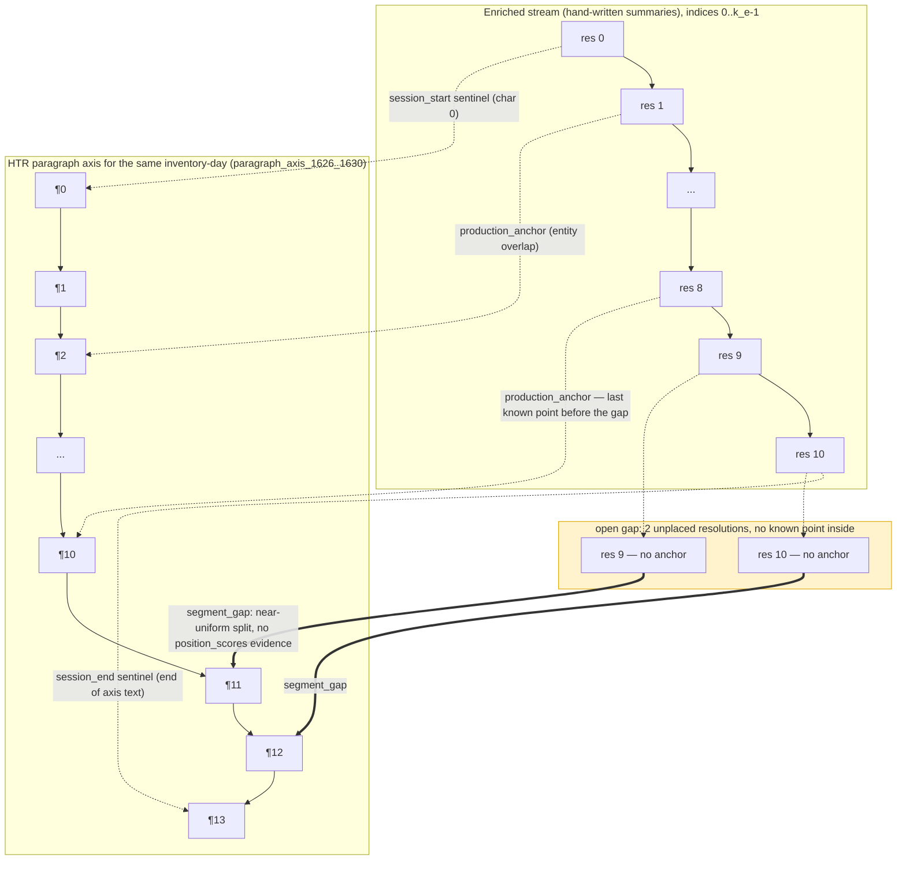

# Writeup Alignment, Anchors, Dynamic programming
<!-- doc-status: active -->

### Aim

The purpose is to align the sequences of resolutions of the modern Dutch, hand made  summariies of the 1626-1630 resolutions of the States General to the HTRd and subsequently parsed version of the same resolutions in 5 different archive numbers corresponding to books. Resolutions were taken (almost) daily in the sessions of the SG. They each live in different datasets:

- enriched resolutions (`enriched_resolutions_1626_1630`) for the summaries
- flat resolutions (`resolutions_flat`), and as a fallback the session text (`sessions_json_source`, however they are also in an elastic search index, which is easier to query (XXX look this up))
- all paragraphs of the htr parsing are in `paragraph_axis_1626_1630`

> **[Claude's note, 2026-09-29]:** There are 7 inventories in scope, not 5 — the 5 annual ones (3185–3189) plus two non-annual "secret resolution" series (4562, 4861). They behave structurally differently: 4562 breaks order-preservation and is anchor-starved, 4861 has essentially no HTR axis at all (`plans/COLLISION_AVOIDANCE_TRACK.md` Step 1 finding C / Step 6). Worth naming explicitly, since most mechanisms discussed below only apply to the 5. *Refs: `plans/COLLISION_AVOIDANCE_TRACK.md` (Step 1 finding C table, Step 6 in-scope-counts table); `data_manifest.toml` (inventory registrations); `scripts/landmark_density_eval.py`.*

> **[User + Claude's note, 2026-09-29] — 4562/4861 are the secret resolutions, and that reclassifies them from "structural ceiling" to "deferred retrieval problem".**
>
> **What the user established (domain knowledge, not measured here):** 4562 and 4861 hold the *secret* resolutions. Only a minority of resolutions were secret. Their content is **not present in the ordinary resolutions text** — it appears only in the summaries, which carry a dedicated `secret` metadatum. Finding them should be tractable with the TF-IDF procedure, but as a **cherry-picking retrieval** over a separate corpus, not as stream alignment — a different design. **Decision: stashed for later, deliberately not scoped now.**
>
> **How this compares to the loss analysis (measured 2026-09-29, read-only from data on disk).** A census of `resolution_concordance_1626_1630` found 5,746 of 19,120 enriched resolutions carry no paragraph range, decomposing into `missing_htr` 4,482, `cross_day_shift` 1,137, `nihil_actum` 127. The 4,482 sit **entirely** in 4562 (2,095) and 4861 (2,387); inventories 3185–3189 have exactly zero, corroborating the Step 6 note above from a second direction. 4861 is 100% unpaired, 4562 87.2%. Four consequences:
>
> 1. **The framing changes, the number does not.** The census called these a structural ceiling — unreachable. They are not unreachable; they are out of scope for *stream alignment specifically*. Absent HTR text in the ordinary stream is not a segmentation failure, and counting it as one understates the aligner on the population it actually addresses. Stream-alignment performance is an **annual-inventory story: 14,240 resolutions**, where the only unpaired causes are `cross_day_shift` (1,057) and `nihil_actum` (127). `PLAN.md`'s three-denominator reporting rule (19,120 / 13,530 / 11,644) should carry the secret series as a fourth, separately-targeted population rather than folding it into the same ceiling.
> 2. **It explains a previously-unexplained measured anomaly.** The order-preservation note above records 4562 as the one confirmed exception (15 non-monotone steps, mean offset run length 4.97). If secret resolutions are lifted out of the ordinary session flow and filed separately, order-breaking *relative to the enriched stream* is exactly what one would predict — the anomaly now has a cause rather than only a measurement. The same mechanism plausibly explains why 4562 is anchor-starved (7.6% pinned vs. a 18.9% corpus average, `PLAN.md` S6b): anchors cannot form against text that is not in the stream being anchored.
> 3. **The `secret` metadatum is currently unusable — this is a real data gap, not a modelling choice.** The field exists on every record but is `False` on **all 19,121** rows of `enriched_resolutions_1626_1630_complete.json` and all 19,120 of the concordance. It was preserved structurally and dropped in content somewhere between the source XML (the `file` column still points at e.g. `162716ju.xml`) and the derived JSON. Today the **inventory id is the only available proxy** for "secret", and it is inventory-level where the user's description implies a resolution-level property. Since only a minority were secret, a per-resolution flag is strictly more informative than the 4562/4861 split — recovering it from the source XML is a **prerequisite** for the deferred design, and it is the kind of loss `CLAUDE.md`'s "never discard archival metadata fields during transforms" rule exists to prevent.
> 4. **"Relatively easy with TF-IDF" is plausible but not yet evidenced — and the gap is this document's own recurring lesson.** The 2026-09-29 TF-IDF result below (AUC 0.9555, top-1 0.9518) was measured on **same-day** discrimination: picking the correct flat text among that day's own alternatives, a pool of roughly 10–40. Cherry-picking retrieval across a separate inventory is a pool two to three orders of magnitude larger, and at that size a 0.955 pairwise AUC still admits many false positives at top-1. So the existing measurement does **not** transfer to the retrieval task; it answers an easier question. Any build here needs its own calibration against a max-over-pool null (score each secret summary against a same-size pool from a disjoint period, cut at the 99th percentile of the null-max distribution) plus a positive control for sensitivity — exactly the discipline `tfidf_similarity_pair_discrimination_eval.py` already applies, re-derived for the larger pool.
>
> *Refs: `resolution_concordance_1626_1630` (census source); `data/derived/enriched_resolutions_1626_1630_complete.json` (the all-`False` `secret` field); `scripts/s4_resolution_concordance.py` lines 143–150 (the `cross_day_shift` discard); `plans/COLLISION_AVOIDANCE_TRACK.md` Step 1 finding 3 and Step 6; `PLAN.md` S6b (4562 anchor starvation) and the acceptance-criteria denominators; `scripts/tfidf_similarity_pair_discrimination_eval.py` (the calibration pattern to re-derive).*

As a point on departure we assume the resolutions in both sets are in the same order. Some resolutions were secret and live in another archive file.

> **[Claude's note]:** This has actually been measured, not just assumed: zero non-monotone steps for content-verified session landmarks across the five annual inventories (`COLLISION_AVOIDANCE_TRACK.md` Step 1, finding 3). 4562 is the one confirmed exception (15 non-monotone steps, mean offset run length 4.97). Worth citing as "verified, with one named exception" rather than stated as a premise. *Refs: `plans/COLLISION_AVOIDANCE_TRACK.md` Step 1 ("Verified landmarks are order-preserving" finding 3); `scripts/landmark_density_eval.py` + `tests/test_landmark_density_eval.py`; dataset `landmark_density_eval`.*

### Problem

The problem is that the HTR and the parsing process are imperfect:

- The sessions do not all have the correct date, and they are not always correctly parsed
- Not all resolutions were separated. There are paragraphs and all resolutions consist of one or more paragraphs. Not all paragraphs are perfectly separated either. They sometimes contain more than one paragraph, and sometimes the contain half a paragraph.
- the summaries should be regarded as the reference line
- the content of the resolutions is the same, the wording is different because they are summaries vs full text.
- sometimes the htr sequence may be disrupted but in general the order of text is not disturbed. An check may consist in comparing the resolutions to the sessions text, although this is also parsed and misparsing at that level may propagate to the resolutions level.

> **[Claude's note]:** This last point is also already measured, not just a plausible check — it's the same Step 1 order-preservation result cited above. And "not all resolutions were separated" is quantified precisely: 81.1% of session-days are HTR under-segmented (K_f < K_e, S1-D1), with only 3.8% hitting exact resolution counts. *Refs: `PLAN.md` "S1 — four zero-annotation diagnostics" section (D1/D1c/D2/D2b results); `plans/COLLISION_AVOIDANCE_TRACK.md` Step 1 finding 3 (order-preservation); `docs/SEGMENTATION_TRANSFER.md`.*

### Points of Departure and Method

If parsing would be perfect, both 'streams' of resolutions could be 'zipped' mechanically. This is not the case, therefore we try to reconcile the streams by aligning them. We use the analogy of ancient DNA matching, as we try to match garbled islands of sequences to a know baseline sequence. In order to do so we reduce all alignment signals to anchors that can be placed on the HTR sequence. We have different signals that can be translated to anchors.

> **[Claude's note]:** One place the project explicitly departs from the aDNA analogy, and it's load-bearing rather than incidental: insertion is not a modelled event on the HTR side. An enriched resolution with no distinct HTR match is routine (deletion — 81.1% under-segmentation); the converse — an HTR span belonging to no enriched resolution — has never been observed. `COLLISION_AVOIDANCE_TRACK.md` Step 3 names this directly: "this is where it differs from aDNA procedures... aDNA reads carry genuine insertions, editorial summaries of a fixed archive do not." Worth stating as a hard constraint alongside the analogy, since it changes what a DP's move set is allowed to do (see the new section below). *Refs: `plans/COLLISION_AVOIDANCE_TRACK.md` Step 3, "Resolution level: deletion is the norm, insertion is not a modelled event"; `scripts/s6b_known_point_ledger.py` (`align_entity_mentions` docstring encodes this structurally).*

- the sessions and the resolutions in them.
  - there are days on which there was no session.In the summaries and in the HTR text these were designated as Nihil Actum. These can serve as primary anchors, in addition to the beginning and the ending of inventory number. Often the HTR parsing made these signs disappear which makes them hard to compare, but the corresponding dates still should have no resolutions. As a rule of thumb, the no-session days comprise sundays and holidays (christmas, easter, pentecost etc)

    > **[Claude's note]:** Already tried and it redirects — `COLLISION_AVOIDANCE_TRACK.md` Step 6, "Nihil-actum as an alignment signal". Findings: 75% of nihil days leave literally no textual trace at all (implicit collapse into a neighbouring session, no marker); the 25% that do carry an explicit HTR marker sit at the *tail* of a session, not the opening, and land exactly one day from the enriched nihil date in only half of cases. Verdict there: usable only as a one-sided **skip constraint** on the enriched stream (a nihil sitting must consume zero HTR sessions) — explicitly *not* a two-sided content anchor; that framing was tested and withdrawn (the first pass's 138-marker figure was 86% false positive, mostly `vacatien` = travel fees, unrelated to `nihil actum`). Also, "sundays and holidays (christmas, easter, pentecost etc)" states more than was verified: measured is 112/127 (88%) Sundays, the other 15 "presumably" feast days, never itemized by name. *Refs: `plans/COLLISION_AVOIDANCE_TRACK.md` Step 6, "Nihil-actum as an alignment signal (user, 2026-09-25) — checked, and it redirects"; `scripts/metrics_nihil_actum_invariant.py` + `tests/test_metrics_nihil_actum_invariant.py`; dataset `metrics_nihil_actum_invariant`.*

  - comparing the date assigned to the sessions, this may point to structural shifts or omissions that can be translated to anchors

    > **[Claude's note]:** This is Step 6 of the collision-avoidance track, and the gate did **not** pass for building a session-level aligner on the main corpus: in the five annual inventories every enriched sitting already resolves to an HTR session (zero `missing_htr` rows there), so there is no unmapped population left for a session aligner to fix outside 4562/4861. The mechanism was confirmed real — order reaches correspondences a ±1-day date window structurally cannot — but only for 3 sittings / 40 resolutions, against a 718-resolution stretch gap. Worth citing as "confirmed but thin," not as an open avenue with unknown payoff. *Refs: `plans/COLLISION_AVOIDANCE_TRACK.md` Step 6 ("Session-level sequence alignment between the two streams", GATE DID NOT PASS); `scripts/session_offset_eval.py` + `tests/test_session_offset_eval.py`; dataset `session_offset_eval`; `docs/DECISIONS.md` 2026-09-25.*

  - each non-Nihil Actum session contains a number of resolutions, that should be the same between the summaries and the htr version. If not, sequential comparison may give clues to where the shifts were.

    > **[Claude's note]:** This is exactly `metrics_ke_drift_diagnostic` (K_e vs K_f per day), already built and the backbone of the whole segmentation-transfer effort — 203 drift candidates at the fixed threshold. Solid match, no gap here. *Refs: `scripts/metrics_ke_drift_diagnostic.py` + `tests/test_metrics_ke_drift_diagnostic.py` (per-day version); `scripts/metrics_ke_kf_window_drift_diagnostic.py` (windowed variant, used on the longest `weak_separation` gaps).*

- For both streams there are sequences of entities that have been recognized. These are not the same, because of different interpretations, but the entities should be in the same order even if there are gaps. It is best to try and align them by resolution. However, for the HTR Note that the entity stream comparison can both contribute to and benefit from advances in resolution alignment

  > **[Claude's note]:** This is Step 3's exact proposal (order-constrained alignment over entity mentions), and it was built and tested on 2026-09-28. The result was net negative against a matched control (exact start-paragraph agreement 0.2308 vs. 0.5385) — but see the Dynamic Programming section below for why: two real implementation bugs were fixed before that measurement, and what's left unaddressed is a specific design choice (unit-cost matching) that the project's own plan already names as the next lever, not yet tried. Read together with the entity-order consistency gate that passed first (Kendall τ 0.809 for common entities vs. 0.174 control), this looks more like "the tested aligner doesn't yet exploit a real signal" than "entity order doesn't help" — worth reopening with a graded-cost aligner before treating the idea as closed. *Refs: `plans/COLLISION_AVOIDANCE_TRACK.md` Step 3 (full section, gate + first-experiment write-up); `scripts/d1c_idf_band_order_eval.py` + `tests/test_d1c_idf_band_order_eval.py` (the order-consistency gate); `scripts/s6b_known_point_ledger.py` (`align_entity_mentions`) + `tests/test_s6b_known_point_ledger.py`; `scripts/s6d_entity_mention_gap_placement.py` + `tests/test_s6d_entity_mention_gap_placement.py`; `scripts/s6d_entity_alignment_gap_eval.py`; `docs/DECISIONS.md` 2026-09-25 and 2026-09-28 entries.*

- we have made an llm try to line up the summaries and the htr versions. An added idea is to make fingerprints of the resolutions and try to compare these to each other. The idea of fingerprints is to find a way to overcome the structural differences between the htr and the summary representation (XXX test this out on known resolutions)

  > **[Claude's note]:** The LLM-judge half of this was tested (S1-D2): 60.0% precision vs. a 53.7% baseline — near noise. The "fingerprints of resolutions" idea is genuinely different from anything already tried: `s6b_session_fingerprint_match.py` fingerprints HTR-vs-HTR session text for content verification, not enriched-summary-vs-HTR-resolution matching. This reads as the one clearly open, non-redundant idea in the document, and it lines up with where `docs/STATE.md`'s "Active Focus" currently sits — deciding what to try next for the open-gap majority now that Step 3's first experiment has closed (see below). *Refs: `PLAN.md` "S1 — four zero-annotation diagnostics", D2 sub-result; `scripts/s6b_session_fingerprint_match.py` + `tests/test_s6b_session_fingerprint_match.py`.*
  >
  > **[Claude's note, follow-up]:** A fourth candidate for "reliable content comparison" already exists in the codebase and is worth naming alongside fingerprints and the LLM judge: **dense semantic embeddings** (cosine similarity between enriched summary text and flat/HTR text). It's built (`alignment_embeddings.py`, TF-IDF/GysBERT/Ollama `nomic-embed-text` backends) and wired into the production NW aligner via `semantic_weight`/`similarity_matrix`, but it ships **off by default** (`align_session`'s `semantic_weight=0.0`, `build_alignment_new`'s `use_embeddings=False`), sits in a `PLAN.md` section marked `doc-status: retired`, and — unlike phrase-matching, entity-order alignment, and the LLM judge — was never run through the S0 gold-evaluation harness on its own to measure whether it actually helps. It was superseded by the entity-overlap NW pipeline when the project reframed around segmentation-transfer, not measured and rejected. Of the four content-comparison ideas on the table, this is the one that's already built, cheapest to test (TF-IDF backend), and least evidenced either way — the natural next diagnostic before investing in anything heavier (e.g. LLM-summarize-then-compare). *Refs: `alignment_embeddings.py`; `build_alignment_new.py` (`align_session` — `semantic_weight`, `similarity_matrix`, `min_semantic_threshold` params, all off/unused by default); `PLAN.md` "NEW Approach: Semantic & LLM-Assisted Resolution Alignment" (retired section, Option A); `scripts/s4_candidate_scoring.py` (the one place embeddings are actually consumed today, for session-date-ledger candidates, validated on a 6/7 sample — a different, narrower use than resolution-content comparison); `docs/STATE.md` "Active Focus".*
  >
  > **[Decision, user + Claude, 2026-09-29]:** Pursued the embeddings diagnostic (TF-IDF backend only, against a within-day pooled-derangement control, same discipline as `d1c_idf_band_order_eval.py`). **Result: positive, and a real margin.** On a seeded stratified sample (150 days, 892 `tier1_anchor` positive pairs vs. 2,190 within-day-derangement negative pairs): positive-pair similarity mean/median **0.180 / 0.178** vs. negative **0.069 / 0.067**; discrimination (common-language effect size / AUC) **0.9555**; same-day top-1 accuracy (the correct flat text scores highest among that day's own alternatives) **0.9518**; consistent across all five main inventories (per-inventory AUC 0.945–0.967). This is a real, large margin over the entity-bag score's flat 0.957-vs-0.962 — confirmed independently: `alignment_1626_1630.parquet`'s own `semantic_similarity` column is literally **0.0 on all 13,342 rows**, i.e. embeddings have contributed nothing to production, ever. Standalone measurement only — `align_session`'s `semantic_weight`/`use_embeddings` defaults are untouched, nothing wired into production; whether wiring it in would actually improve corpus-wide placement (vs. just being separable in principle) is a distinct, unanswered follow-up question. *Refs: `scripts/tfidf_similarity_pair_discrimination_eval.py` + `tests/test_tfidf_similarity_pair_discrimination_eval.py` (18/18 passing); dataset `tfidf_similarity_pair_discrimination_eval`; `docs/DECISIONS.md` 2026-09-29 "TF-IDF similarity separates correct from wrong enriched<->flat pairings, unlike the entity-bag score"; verified directly against the output file's own summary record, not just the session report.*
  >
  > **Postpone fingerprinting** — it has not been tried in any form, so there is nothing to measure yet. Worth flagging for later, not now: fingerprinting and the entity-mention stream (Step 3, closed negative on its first build) may cross-fertilize — a resolution-level content fingerprint could plausibly serve as exactly the kind of graded, whole-resolution grounding signal Step 3's unit-cost aligner currently lacks (it only sees individual entity-name string equality). Not scoped or designed; parking the idea here rather than building it.

- the alignment has a global aspect and a local aspect, as the existing anchors divides the global sequence into parts. Most content wise comparisons are local, not global

  > **[Claude's note]:** Matches what's already built: `s6b_known_point_ledger.py`'s global chain of typed known points, with `s6c_gap_segmentation.py`'s `segment_gap` filling locally inside each gap. See below for how that global+local split is actually implemented as dynamic programming, and what each attempt found — including why "negative" doesn't always mean "no signal." *Refs: `scripts/s6b_known_point_ledger.py`; `scripts/s6c_gap_segmentation.py`; `docs/S6B_CONSTRAINT_BASELINE.md`; `docs/steps/STEP_S6_anchor_chain_alignment.md`.*

---

## Anchor mechanism: schema and a worked example

> **[Claude's note, 2026-09-29]:** Added at your request, and pulled from live data, not invented — see "How to reproduce this" at the end. The schema is a diagram of the mechanism the paragraphs above describe in prose; the worked example is one real inventory-day (1626-01-01), traced through every stage: the known-point chain, the one real gap on that day, what the DP filled it with, and a check of the result against the actual resolution content.

### Schema

`s6b_known_point_ledger.py` (or, in production, `s4_corpus_paragraph_predictions.py`'s live call to `align_session`) builds the solid/dashed part — the chain of typed known points (`session_start`, `production_anchor`, `session_end`, plus gold boundaries when scoring against gold). Everything between two consecutive known points is a **gap**: a count of unplaced enriched resolutions with no independent evidence of their own. `s6c_gap_segmentation.py`'s `segment_gap` (the double-arrow step above) is what fills it — see the Dynamic Programming section below for exactly how.

### Worked example: 1626-01-01 (inventory 3185)

This day has `k_e = 11` enriched resolutions and 9 flat/HTR resolutions (`K_f < K_e`, the ordinary under-segmentation case), split into 14 paragraph-axis rows once opening-phrase sub-segmentation is applied. 9 of the 14 axis rows are directly claimed by a `production_anchor` or sentinel; the remaining span — after the last anchor (resolution 8) to the session end — is one open gap holding exactly 2 unplaced resolutions (9 and 10).

| enriched res. | opens at axis position | how it got there | axis text (start) | matches enriched summary? |
|---|---|---|---|---|
| 0 | 0 | `session_start` sentinel | "Actere ende Resoltaren vande ho:Mo: heeren..." (session header text) | — (header, not content) |
| 1 | 2 | `production_anchor` | "Synde gerapporteert datte heer Ambassadeur van Vranckryck aengenomen heeft..." | yes — "De Franse ambassadeur..." |
| 2 | 3 | `production_anchor` | "Synde geproponeert dat die vande Magistraet tot Rotterdam, versoucken copie..." | yes — "verzoek van de Rotterdamse magistraat..." |
| 3 | 4 | `production_anchor` | "Synde geproponeert dat binnen Deventer publicatie soude syn gedaen..." | yes — "...publicatie in Deventer" |
| 4 | 6 | `production_anchor` | "Ontfangen een missive vanden Colonel Haetzfelt gescreven te Hamborch..." | yes — "Kolonel Haetzfelt verzoekt per brief..." |
| 5 | 7 | `production_anchor` | "Synde gisteren gewoegen de goude Lampetten voor den hertoch van Buckingam..." | yes — "De gouden lampetten voor de hertog van Buckingham..." |
| 6 | 8 | `production_anchor` | "Ontfangen een missive vanden Resident Aissema gescreven te Hamborch..." | yes — "...resident Aissema schrijft..." |
| 7 | 9 | `production_anchor` | "Ontfangen twee missiven vanden heer Joachimi..." | yes — "Joachimi schrijft d.d. Windsor..." |
| 8 | 10 | `production_anchor` — **last known point; gap starts right after** | "Ontfangen een missive vanden Agent Brederode gescreven te Basel..." | yes — "Brederode schrijft d.d. Bazel..." |
| **9** | **11** | **`segment_gap` (DP-filled, no anchor)** | "Ontfangen een missive van Georgh Friderich Marckgraeff tho Baden..." | yes — "Ontvangen een brief van Georg Friedrich..." |
| **10** | **12** | **`segment_gap` (DP-filled, no anchor)** | "Is goetgevonden ende gearresteert het concept vande missive dienende tot uytschrijvinge..." | yes — "HHM arresteren het concept van de biddagsbrief..." |

Reading the gap in `segment_gap`'s own terms: `low_anchor = 10` (resolution 8's position, exclusive), `high_anchor = 14` (session end), `count = 2`. With no `position_scores` evidence supplied for this corpus run (the live default), the DP's `ideal` term places the 2 slots at a near-uniform split of the 3 free positions (11, 12, 13) — which lands on **11 and 12**, leaving axis row 13 ("Gedelibereert synde wat ordre soude dienen gehouden te werden") as resolution 10's trailing extent (2 paragraphs, ≤ 3 — still `separated` by the project's own criterion).

On this day, the near-uniform default happens to be exactly right: every one of the 11 resolutions — both the 9 anchor-derived placements and the 2 DP-filled ones — lands on the axis paragraph whose content genuinely matches its enriched summary, checked by hand above. That is not a claim that `segment_gap` is generally this accurate (the corpus-wide separated-accuracy numbers cited earlier, 0.628 exact on separated placements, 0.639 on gold's segmentable days, are the honest average); it is one concrete instance of the general mechanism working as designed, on a day where the gap was narrow enough (3 free paragraphs, 2 resolutions) for the uniform default to be a good guess.

**How to reproduce this.** Pulled 2026-09-29 directly from data on disk, filtering each file to `date == "1626-01-01"`:
- known-point chain and gap: `output/s6b_known_point_ledger.jsonl`
- axis paragraph text and ordering (sort by the numeric suffix of `flat_id`, then by `para_index` — `para_index` alone is the position *within* one flat resolution, not the day-level order): `output/paragraph_axis_1626_1630.jsonl`
- enriched summary text: `data/derived/enriched_resolutions_1626_1630_complete.json`, filtered on `date` and sorted by `resolution_index`
- the actual final placement (the `boundaries` list, `source: "s6c_gap_segmentation"`): `output/s4_corpus_paragraph_predictions.jsonl`

---

## Dynamic Programming: mechanism and implementation

> **[Claude's note, 2026-09-29]:** Added at your request. This is a technical restatement of code and measured results already on disk (`build_alignment_new.py`, `scripts/s6c_gap_segmentation.py`, `scripts/s6b_known_point_ledger.py`) — none of it is new proposal, all of it has been run against gold at least once. I've also dug into *why* each negative result happened, since a flat "closed negative" can hide whether the underlying idea failed or the specific scoring mechanism did.

There are three distinct DP mechanisms in the codebase, at three different granularities, tried in this order.

**1. Resolution-level Needleman–Wunsch — `align_session` (`build_alignment_new.py:900`).**
Sequence unit is the *resolution*: rows are `enriched_ids`, columns are `flat_ids`. The cell score is `sum(idf_weights.get(e, 1.0) for e in shared_entities)` — a bag of shared overlap entities between the two resolutions, IDF-weighted, with mention order inside each resolution discarded entirely. A gate (`anchor_only_diagonal`) forbids the diagonal (match) move unless `entity_match_score > 0` or dense semantic similarity clears a threshold; without that, the diagonal is forced to `NO_ANCHOR_DIAG_SCORE` (effectively −∞), so two resolutions with zero shared entities can never be matched directly. Off-diagonal moves carry a flat linear gap penalty (`gap_penalty=0.1`). A companion tiered variant, `align_session_milestone_tiered`, re-expresses the same anchors as confidence tiers: **tier1** = anchor cells clearing `anchor_threshold` (2.0), filtered to a monotone subsequence; **tier2** = positions interpolated/merged/extrapolated between tier-1 anchors; **tier3** = tail extrapolation beyond the last anchor. This is the alignment that populates `alignment_1626_1630.parquet`. **Correction, 2026-09-30: it is *not* what production runs for placement.** `scripts/s4_corpus_paragraph_predictions.predict()` calls `align_session` (`:900`) directly, at paragraph-axis granularity via `build_axis_overlap` — so it uses neither `anchor_threshold=2.0` nor the `clean_anchors` monotone filter (`:838-851`), and monotonicity comes from the NW traceback itself. It never reads `alignment_1626_1630.parquet` or its `tier1_anchor` label at all (`data_manifest.toml:656`), and the two anchor sets agree only **65.7%** of the time, 62.9% on exact position (`anchor_set_reconciliation`, `data_manifest.toml:271`). Treat the tiered variant as the parquet's provenance, not as the placement path. Known weakness: `nw_matches_gt_rate` is 0.957 for correct pairs and 0.962 for false positives — the entity-bag score barely discriminates a right resolution pairing from a wrong one (`PLAN.md`, "Hypothesis"). *(Likely also partly an artifact: the overlap tables keep a 4-way provenance category but no similarity column, so an orthographic variant like `Frankrijk`/`Vranckryck` is stored indistinguishably from an exact hit — the binary match representation may be discarding real discriminative information, not just failing to find any.)* *Refs: `build_alignment_new.py:795` (`align_session_milestone_tiered`, tiering) and `:900` (`align_session`, the NW core); `PLAN.md` "Hypothesis" section (`nw_matches_gt_rate` 0.957/0.962); dataset `alignment_1626_1630.parquet`.*

**2. Count-constrained gap-segmentation DP — `segment_gap` / `segment_day` (`scripts/s6c_gap_segmentation.py`).**
Sequence unit is the *paragraph index* (no character offsets). Given a gap of `count` unplaced resolutions bounded by two known anchors `(low_anchor, high_anchor)`, `segment_gap` chooses `count` non-decreasing paragraph positions — repeats allowed — maximizing a score that trades an even/uniform split of the gap against an optional externally supplied `position_scores` bonus (e.g. phrase-hit or entity-presence evidence). The DP itself is a small "choose k ordered items to maximize score" table: `dp[k][i]` = best score filling `k` of the `count` slots using the first `i` candidate positions, with a skip/take recurrence and a boolean `took` table for the backtrack. `segment_day` wraps this: it first clips out-of-order raw anchors forward into a strictly non-decreasing backbone (instead of aborting, which the old `interpolate_positions` did whenever anchors tied or inverted), then runs `segment_gap` in every interior gap. It **never abstains** — the key operational difference from the paragraph-axis baseline it replaced. Swapping it in moved predicted-day coverage from 9/21 to 19/21 gold days, with paragraph-level (lumped) F1 essentially flat (0.828 → 0.826): a coverage win, not an accuracy win. *Refs: `scripts/s6c_gap_segmentation.py` + `tests/test_s6c_gap_segmentation.py`; `docs/steps/STEP_S6_anchor_chain_alignment.md`; `PLAN.md` S6c session notes, 2026-09-21.*

*Why the `position_scores` bonus attempts went negative — artifact, not (only) a null result.* Five variants of Group B (`entity_surface_matches_1626_1630`) and Group C (`s4_opening_phrase_candidates`) evidence were fed into the bonus term; all scored at or below the no-evidence baseline (0.644 paragraph tol0 F1). But this was chased down, not just accepted: per-day comparison showed Group B regressed 11/19 days by a net −21 true-positive cuts, while Group C regressed only 8/21 days by −2 — an order of magnitude apart, which overturned an earlier "same mechanism, same failure" reading. Root cause for Group B, traced to a specific day: `entity_surface_matches` is keyed at **flat-resolution-id** granularity, so every sub-paragraph of a multi-paragraph resolution receives an *identical* bonus — the evidence has zero power to discriminate within it. Relocating the bonus to the exact matched paragraph (`.find()`) and then restricting to two-sided-grounded matches recovered part of the regression (0.555 → 0.543 → 0.588) but never closed back above 0.644. Reading it straight: **part of this negative result was a genuine implementation artifact (flat_id-level granularity), confirmed and partly fixed** — and a **real residual gap survives the fix**, because entity/phrase *presence* is measurably a different quantity from resolution-*opening position*, and the bonus-vs-even-split formula has no way to tell them apart even when correctly localized. *Refs: `docs/DECISIONS.md` 2026-09-21 and 2026-09-23 (Group-B/Group-C `position_scores` entries, including the "correcting the mechanism exhausted overreach" retraction); `scripts/s6_group_b_position_scores_eval.py`, `scripts/s6_group_b_relocated_position_scores_eval.py`, `scripts/s6_group_b_grounded_position_scores_eval.py`, `scripts/s6_group_b_candidate_grounded_position_scores_eval.py` (+ matching `tests/`).*

**3. Entity-mention edit-distance DP — `align_entity_mentions` (`scripts/s6b_known_point_ledger.py:117`).**
Sequence unit is the individual *entity mention*, in reading order — a dense stream of low-value symbols, one per shared-vocabulary hit, rather than a bag per resolution or a paragraph index. Three unit-cost moves from cell `(i, j)` (i = HTR/flat mention index, j = enriched mention index): **match** `(i+1, j+1)` (cost 0 if the mention strings are equal, else 1), **flat/HTR skip** `(i+1, j)` (cost 1), and **enriched run** `(i, j+1)` (cost 1) — the last move is what lets several consecutive enriched resolutions attach to one HTR unit, the corpus's dominant shape under 81.1% under-segmentation. The no-insertion constraint from above is encoded structurally, not as a cost: there is no move that lets an HTR mention attach to nothing, so an HTR-side "insertion" is disallowed outright rather than merely penalized. Deliberately parameter-free (no IDF weighting, no gap tuning, no anchor gate) — designed as a first experiment testing whether entity *order alone* carries placement signal. *Refs: `scripts/s6b_known_point_ledger.py:117` (`align_entity_mentions`) + `tests/test_s6b_known_point_ledger.py`; `plans/COLLISION_AVOIDANCE_TRACK.md` Step 3, "First experiment — unit-cost edit alignment, deliberately parameter-free".*

The first version of this DP lacked the enriched-run move, so every path from `(0,0)` to `(n,m)` had to advance `i` on every step, requiring `n ≥ m` — unreachable, and silently indistinguishable from "one side was empty," whenever the HTR side recovered fewer mentions than the enriched side. That misdiagnosed 32 of 52 open-gap resolutions as "missing evidence" when both sides actually had entities. Fixed 2026-09-28 by adding the enriched-run move; a second bug (non-word-boundary vocabulary matching, e.g. `over` matching inside `overgelevert`) was fixed the same day. After both fixes, coverage rose from 42.3% to 86.5% of open-gap resolutions — but exact start-paragraph accuracy on the newly-projected subset was **0.2308**, against **0.5385** for a matched control (`segment_gap` run on identical anchor chains, no entity evidence at all). **Closed negative** against the pre-declared threshold (must beat the control). *Refs: `scripts/s6d_entity_mention_gap_placement.py` + `tests/test_s6d_entity_mention_gap_placement.py` (mention extraction, word-boundary vocab, traceback-to-paragraph projection); `scripts/s6d_entity_alignment_gap_eval.py` (wiring to real data + the matched `segment_gap` control); `plans/COLLISION_AVOIDANCE_TRACK.md` Step 3, "Session 2026-09-28 (defects fixed, first experiment measured — closes NEGATIVE)".*

*Artifact or genuine finding?* Both, at different layers. The two bugs above were real implementation defects, and they were fixed — so the final verdict isn't hiding an unfixed one. What remains unaddressed, and is exactly what the plan's own design already flagged as the next lever, is the **unit-cost formulation**: match costs 0 only on exact string equality, and every other move — wrong-name substitution, skip, enriched-run — costs exactly 1, uniformly. That makes the DP indifferent among many equally-priced wrong paths; measured directly, only 21 of 48 projected pairs in the final run were real identical-name matches, the rest free-riding cost-1 substitutions chosen essentially arbitrarily. Meanwhile the D1c gate that justified building this aligner at all — entity mention-order Kendall τ = 0.809 for common-band entities vs. 0.174 for a pooled derangement control — is untouched by any of this; it is independent evidence that mention order really does carry signal. So: **the verdict is accurate for the specific parameter-free, unit-cost aligner that was tested. It is not a clean falsification of "entity order helps placement."** The plan's own pre-declared "second lever" (graded substitution cost, rewarding near-matches like `Frankrijk`/`Vranckryck` over arbitrary swaps) was gated on this first experiment beating the null — a reasonable discipline against tuning before measuring a baseline effect, but one that means the negative result closes *this build*, not the hypothesis. *Refs: `scripts/d1c_idf_band_order_eval.py` + `tests/test_d1c_idf_band_order_eval.py` (the τ=0.809 gate); `plans/COLLISION_AVOIDANCE_TRACK.md` Step 3, "Second, and only conditionally" (the graded-substitution-cost lever, not yet built).*

**Reading the three together.** In two of three cases, going negative was traced to a specific, nameable cause rather than accepted as a verdict on the underlying evidence: Group B's granularity mismatch (confirmed, partly fixed, partial recovery) and the entity-mention DP's unit-cost indifference (diagnosed, not yet fixed). Only the *residual* gap after fixing known artifacts — Group B's presence-vs-opening-position confound after relocation/grounding — reads as a genuine limit rather than a bug. The pattern worth carrying into any future DP proposal on this corpus: before calling a result negative, ask whether the scoring/cost formula can actually represent the distinction the hypothesis needs (opening vs. presence; graded vs. binary match) — several of this project's "negative" results turned out to be answering a different, easier question than the one asked. *Refs: `docs/DECISIONS.md` (2026-09-21, 2026-09-23, 2026-09-28 entries cited above, collected); `docs/STATE.md` "Active Focus" (current open decision: re-run Step 3 on the corrected anchor backbone, or try something else).*
